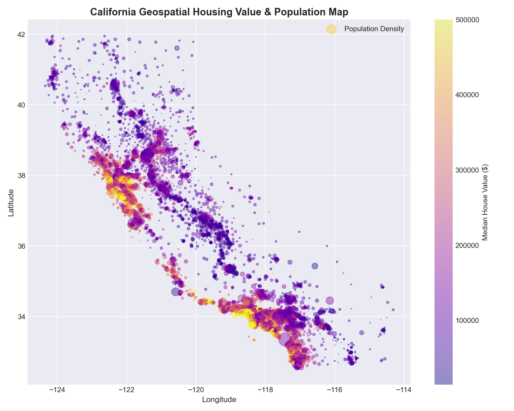
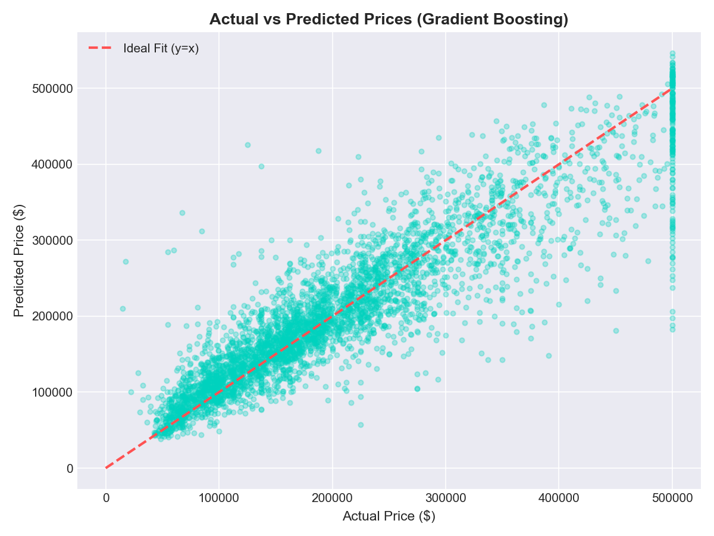
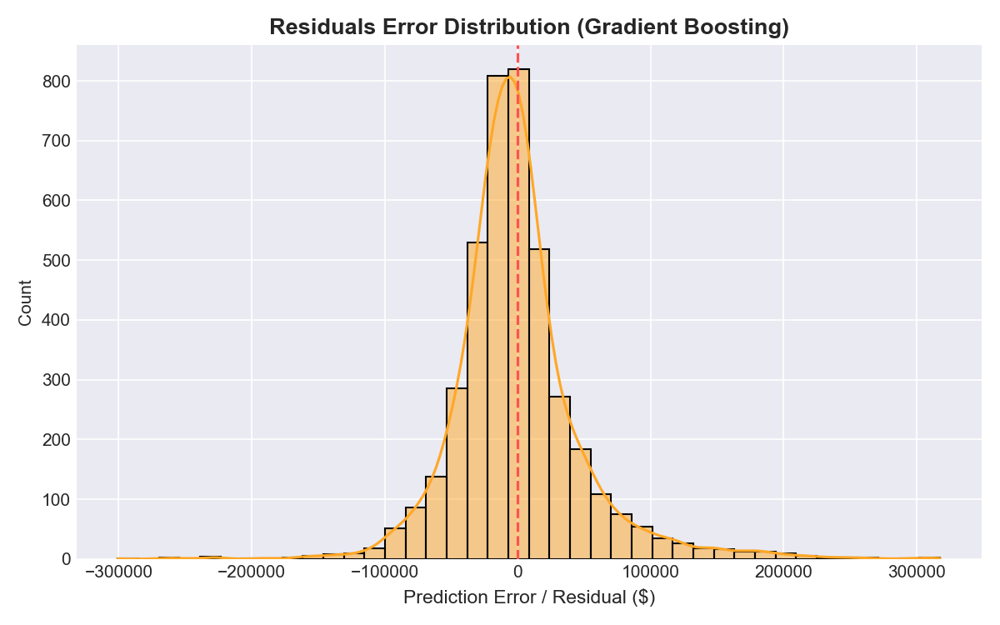
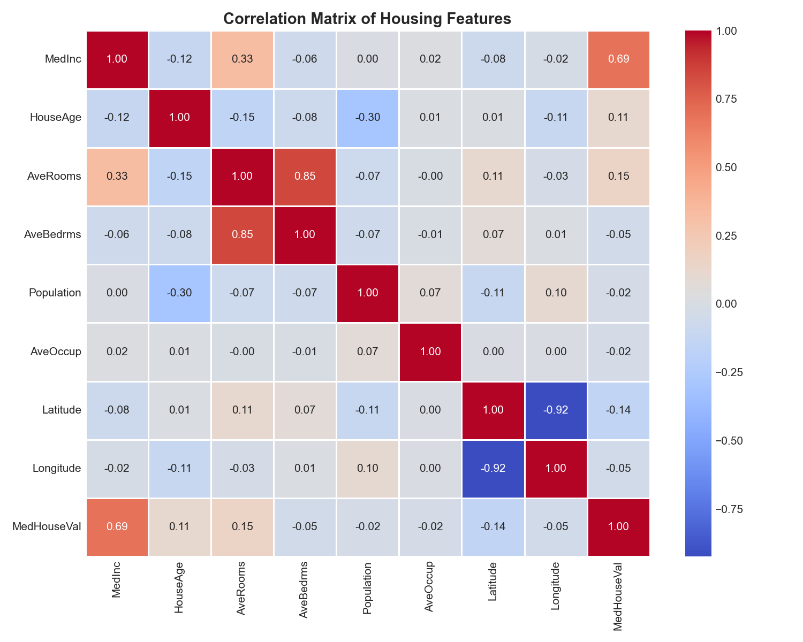
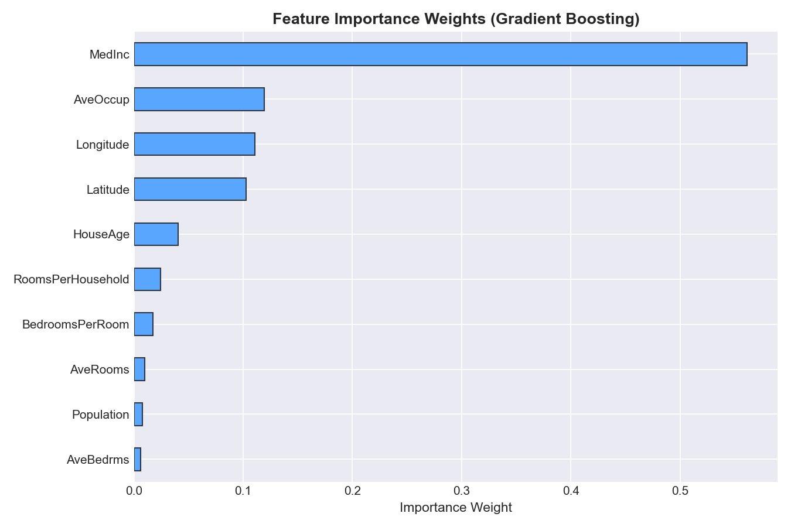

# 🏡 California House Price Prediction & Valuation Pipeline


> **An end-to-end Machine Learning regression and property valuation pipeline evaluating Linear, Regularized (Ridge), Bagging (Random Forest), and Boosting (Gradient Boosting) regressors on California census block data.**

---

## 🎯 Problem Statement & Business Context

Accurate residential real estate valuation is fundamental to mortgage underwriting, property investment, and urban tax assessment. This project constructs an automated valuation model (AVM) that:
- 📈 Predicts median block-group housing values using demographic, geospatial, and structural housing metrics.
- 📐 Engineers domain-specific ratios (`RoomsPerHousehold`, `BedroomsPerRoom`) that improve predictive power.
- 🗺️ Leverages geospatial coordinates to model California's coastal real-estate price premiums.
- 🔬 Benchmarks 4 regression architectures with standard regression metrics ($R^2$, RMSE, MAE).

---

## 📋 Dataset Summary

Dataset covers **20,640 California census block groups** with 8 input features and target `MedHouseVal` (expressed in units of $100,000):

| Feature | Description | Type |
|---|---|---|
| `MedInc` | Median income in block group (in $10k) | Continuous |
| `HouseAge` | Median house age in block group (years) | Continuous |
| `AveRooms` | Average number of rooms per household | Continuous |
| `AveBedrms` | Average number of bedrooms per household | Continuous |
| `Population` | Total block group population | Discrete |
| `AveOccup` | Average number of household members | Continuous |
| `Latitude` | Latitude coordinate | Geospatial |
| `Longitude` | Longitude coordinate | Geospatial |
| `MedHouseVal` | **Target:** Median house value (in $100,000 USD) | Continuous |

---

## 🏗️ Repository Architecture

```
house-price-prediction/
├── data/
│   └── california_housing.csv      # Local snapshot (20,640 records)
├── src/
│   ├── __init__.py
│   ├── data_loader.py              # Data loader with schema validation
│   ├── eda.py                      # Exploratory Data Analysis & visual generation
│   ├── feature_engineering.py      # Ratio creation, scaling, pipeline persistence
│   ├── model_training.py           # Multi-model regressor training
│   ├── evaluation.py               # Model evaluation (RMSE, MAE, R²), residual plots
│   └── predict.py                  # Single-property valuation inference engine
├── visualizations/
│   ├── price_distribution.png
│   ├── correlation_matrix.png
│   ├── geospatial_price_map.png
│   ├── actual_vs_predicted.png
│   ├── residuals_plot.png
│   └── feature_importance.png
├── models/                          # Serialized champion model & scaler
│   ├── best_model.joblib
│   └── feature_pipeline.joblib
├── tests/
│   ├── __init__.py
│   └── test_pipeline.py            # Unit test suite
├── main.py                          # CLI orchestrator runner
├── requirements.txt
├── .gitignore
├── LICENSE
└── README.md
```

---

## 🔬 Model Benchmark Leaderboard

Evaluated on unseen test partition (20% holdout, 4,128 records):

| Model | $R^2$ Score (Accuracy) | RMSE ($100k) | MAE ($100k) | Ranking |
|---|:---:|:---:|:---:|:---:|
| **Gradient Boosting** ⭐ | **0.8176** | **0.4889** | **0.3275** | **1st (Champion)** |
| **Random Forest** | **0.8006** | **0.5112** | **0.3350** | 2nd |
| **Linear Regression** | 0.6519 | 0.6753 | 0.4862 | 3rd |
| **Ridge Regression** | 0.6519 | 0.6754 | 0.4862 | 4th |

> **Champion:** Gradient Boosting delivers an $R^2$ score of **81.8%**, cutting prediction error (MAE) down to ~$32,750 USD across diverse California housing markets.

---

## 📊 Visualizations

### Geospatial Property Value & Population Map


### Actual vs Predicted Prices (Gradient Boosting)


### Residual Prediction Error Distribution


### Feature Correlation Matrix


### Feature Importance Weights


---

## ⚡ Quickstart Guide

### 1. Clone & Set Up

```bash
git clone https://github.com/piyush1008-cyber/house-price-prediction.git
cd house-price-prediction

python -m venv venv
venv\Scripts\activate       # On Linux/macOS: source venv/bin/activate

pip install -r requirements.txt
```

### 2. Run the Full Machine Learning Pipeline

```bash
python main.py
```

### 3. Run Pipeline Fast (Skip EDA Plot Generation)

```bash
python main.py --skip-eda
```

### 4. Run Automated Tests

```bash
pytest -v
```

---

## 👤 Author

**Peeyoosh Kangle**
- 📧 Email: piyushkangle@gmail.com
- 🐙 GitHub: [github.com/piyush1008-cyber](https://github.com/piyush1008-cyber)

---

## 📄 License

This repository is distributed under the MIT License — see the [LICENSE](LICENSE) file.
